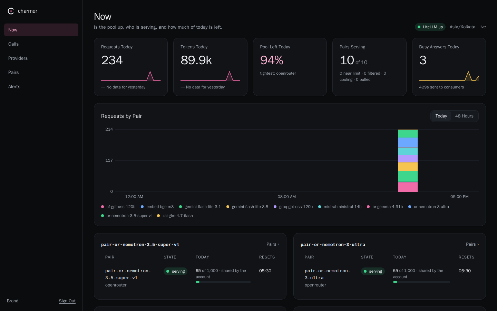
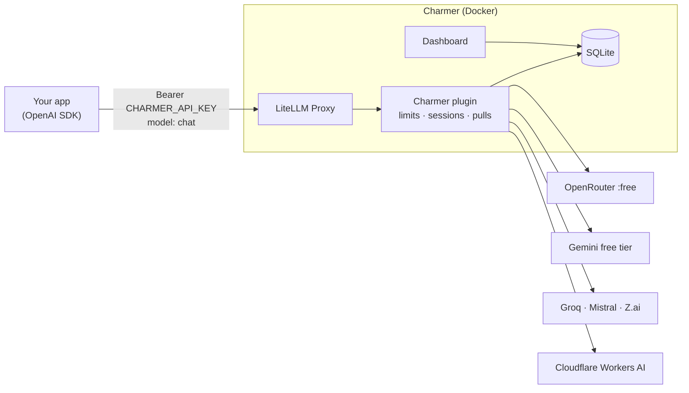
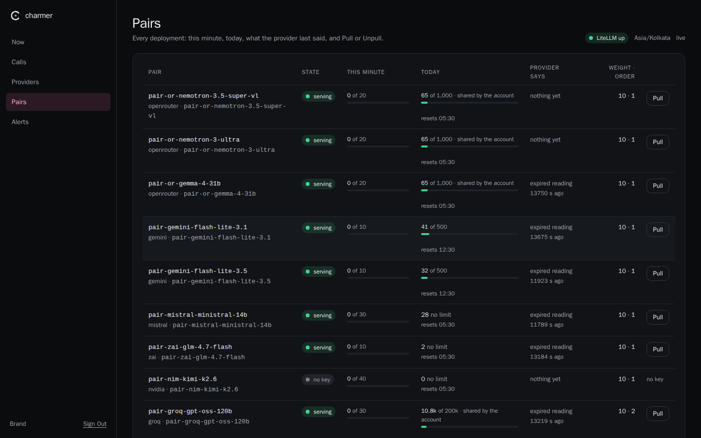
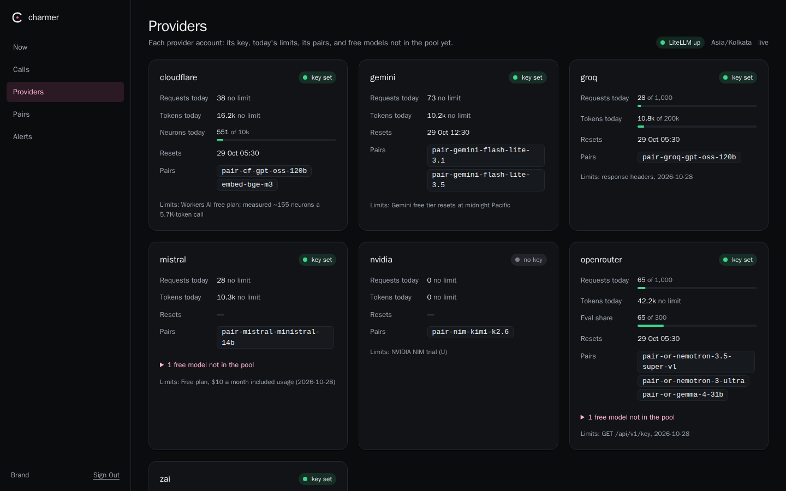
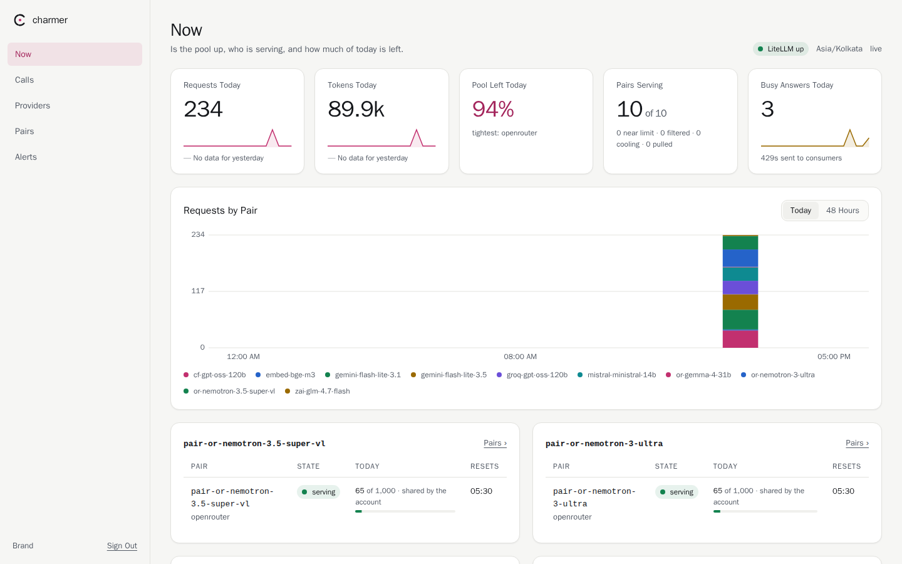
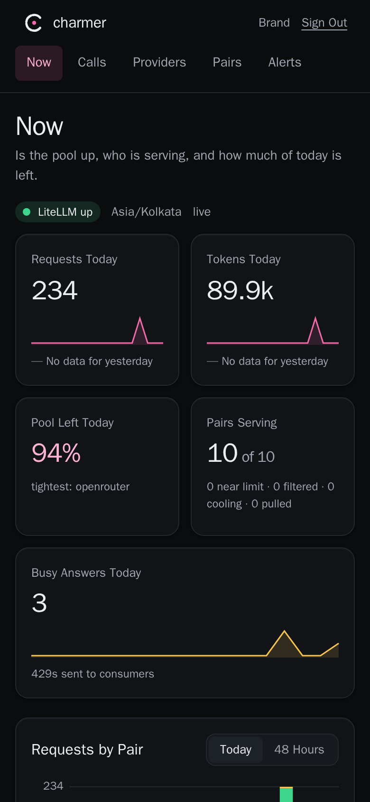

<p align="center">
  
</p>

<h1 align="center">Charmer</h1>

<p align="center">
  <b>Many free LLM tiers, one OpenAI-compatible endpoint. Never a bill.</b><br>
  A self-hosted gateway on <a href="https://github.com/BerriAI/litellm">LiteLLM Proxy</a> that balances load across
  the free tiers you have keys for, keeps each conversation on one model, and says "busy" instead of paying.
</p>

<p align="center">
  
  
  
</p>

<p align="center">
  
</p>

## Why Charmer

Several providers give real models away for free: OpenRouter, Google Gemini, Groq, Mistral, Cloudflare Workers AI
and others. Each free tier is small, though. It might allow 20 requests a minute, 1,000 a day, or 200K tokens.

Charmer pools those tiers behind one key and one URL:

- **One endpoint.** Your app calls `POST /v1/chat/completions` with `model: "chat"`, like any OpenAI API. Charmer
  picks a model that still has room.
- **Limit-aware routing.** A plugin counts every account's minute and day limits, and reads the providers' own
  rate-limit headers. Calls go to a model with room left, before the provider would answer 429.
- **Sticky sessions.** Send a session id, and a conversation stays on one model for as long as that model has room.
  When it has to move, Charmer reshapes the history so the next provider accepts it.
- **Free only, by design.** A start-time guard refuses any model that isn't on the free allow-list. When every
  free tier is used up, your app gets "busy" (HTTP 429), never a paid fallback.
- **A dashboard.** Limits used and left, who is serving, recent calls, providers and their free models, and alerts.
  It has light and dark themes, and works on a phone.
- **Small to run.** It is Docker and one SQLite file: no database server and no Redis. Every command is a `make`
  target.

## How it works



Each model you add is a **pair**: one provider account plus one model.

- **`pair-<slug>` groups.** Every pair gets its own group, so you can test it alone.
- **The `chat` group.** Once a pair passes the live checklist, you add it to `chat`, the group your app calls.
- **Load balancing.** Charmer balances across the pairs in `chat`. It skips any pair that is out of room, cooling
  down, or pulled by you.

## Supported providers

| Provider | Free models in the default config | Key in `.env` |
| --- | --- | --- |
| OpenRouter | Nemotron 3.5 Super VL, Nemotron 3 Ultra, Gemma 4 31B (`:free`) | `OPENROUTER_API_KEY` |
| Google Gemini | Gemini 3.1 / 3.5 Flash-Lite (free tier, billing off) | `GEMINI_API_KEY` |
| Groq | gpt-oss-120b | `GROQ_API_KEY` |
| Mistral | Ministral 14B (Free plan) | `MISTRAL_API_KEY` |
| Z.ai | GLM-4.7-Flash | `ZAI_API_KEY` |
| NVIDIA NIM | Mistral Large 4 (trial) | `NVIDIA_NIM_API_KEY` |
| Cloudflare Workers AI | gpt-oss-120b, bge-m3 embeddings (10,000 neurons a day) | `CF_API_TOKEN`, `CF_AI_API_BASE` |

Leave a key empty and that provider is left out. You can start with just one.

## Quickstart

You need Docker with Compose v2, and `make`. Nothing is installed on the host.

**1. Get the code and create `.env`.**

```sh
git clone https://github.com/hagarwal122/charmer && cd charmer
cp .env.example .env
```

**2. Fill in `.env`.** `make key-new` prints a fresh random key with its line, ready to paste.

| Variable | What to put there |
| --- | --- |
| `LITELLM_MASTER_KEY` | The admin key, 48+ characters: `make key-new NAME=LITELLM_MASTER_KEY` |
| `CHARMER_API_KEY` | The key your app sends: `make key-new` |
| `CHARMER_METRICS_KEY` | The dashboard's read-only key: `make key-new NAME=CHARMER_METRICS_KEY` |
| `DASHBOARD_USERNAME`, `DASHBOARD_PASSWORD` | The dashboard sign-in, set here once: any username, and a password of 16+ characters (`openssl rand -base64 36`) |
| `DASHBOARD_SESSION_SECRET` | A long random string that signs the dashboard's session cookie |
| Provider keys | At least one, for example `GROQ_API_KEY` or `OPENROUTER_API_KEY` |

**3. Start it.**

```sh
make up
```

`make up` does four things:
- verifies the pinned LiteLLM image's signature;
- refuses any non-free model;
- renders the pool for the keys you set;
- starts LiteLLM and the dashboard, and waits until LiteLLM answers.

**4. Check it.**

| What | Where |
| --- | --- |
| API | `http://127.0.0.1:4000/v1` |
| Dashboard | `http://127.0.0.1:8080` (sign in with `DASHBOARD_USERNAME` and `DASHBOARD_PASSWORD`) |

```sh
curl -s http://127.0.0.1:4000/v1/models -H "authorization: Bearer $CHARMER_API_KEY"
```

**5. Admit your first model to `chat`.** `chat` starts empty; until it has a member, it answers busy (429). Check a
pair against its real provider, then add it:

```sh
make live-check PAIR=pair-groq-gpt-oss-120b    # about 15 real calls
make live-matrix                               # a conversation can move between checked pairs
```

To add the pair, copy its block in `config.yaml` with `model_name: chat`, then run `make restart`. The
[guide](docs/guide.md#4-adding-a-model) walks through it.

## Use it from your app

Any OpenAI client works. Point it at Charmer, and send your `CHARMER_API_KEY`.

**Python**

```python
import os
from openai import OpenAI, RateLimitError

client = OpenAI(base_url="http://127.0.0.1:4000/v1", api_key=os.environ["CHARMER_API_KEY"])

try:
    reply = client.chat.completions.create(
        model="chat",
        messages=[{"role": "user", "content": "Write a two-line product description for a silk kurta."}],
        extra_headers={"x-litellm-session-id": "conversation-42"},  # keeps this conversation on one model
    )
    print(reply.choices[0].message.content)
except RateLimitError:
    print("Every free tier is busy right now. Try again in a minute.")
```

**Node.js**

```js
import OpenAI from "openai";

const client = new OpenAI({ baseURL: "http://127.0.0.1:4000/v1", apiKey: process.env.CHARMER_API_KEY });

const reply = await client.chat.completions.create(
  { model: "chat", messages: [{ role: "user", content: "Hello" }], stream: false },
  { headers: { "x-litellm-session-id": "conversation-42" } },
);
console.log(reply.choices[0].message.content);
```

**curl, with streaming**

```sh
curl http://127.0.0.1:4000/v1/chat/completions \
  -H "authorization: Bearer $CHARMER_API_KEY" -H "content-type: application/json" \
  -H "x-litellm-session-id: conversation-42" \
  -d '{"model": "chat", "stream": true, "messages": [{"role": "user", "content": "Hello"}]}'
```

**Embeddings**

```python
client.embeddings.create(model="embed-bge-m3", input=["silk kurta", "cotton saree"])
```

**What to expect back**

| You see | It means | Do |
| --- | --- | --- |
| `200` | Answered. The `x-litellm-model-id` header names the pair that served it | Nothing |
| `429` "No deployments available" | Every free tier in the group is out for now | Retry later; show a "busy" state |
| `400` naming a field | The body carried a non-standard field (`api_base`, `extra_body`, …), or the model isn't a group | Send standard OpenAI fields and a group name |
| `401` | Wrong key | Check `CHARMER_API_KEY` |

Tool calls and streaming work as in the OpenAI API. The full contract is in [the guide](docs/guide.md#10-the-consumer-contract).

## The dashboard

<table>
  <tr>
    <td width="50%"></td>
    <td width="50%"></td>
  </tr>
  <tr>
    <td><b>Pairs.</b> Every deployment: serving, near limit, filtered, cooling, pulled or no key. Shows this minute's and today's use, and what the provider's headers last said. Pull a misbehaving pair with one click; no restart.</td>
    <td><b>Providers.</b> One card per account: today's requests, tokens and neurons against the free limits, when they reset, and the free models it lists that aren't in your pool yet.</td>
  </tr>
  <tr>
    <td></td>
    <td align="center"></td>
  </tr>
  <tr>
    <td><b>Light theme</b>, following your system setting.</td>
    <td><b>On a phone.</b> Every page works at 390 px.</td>
  </tr>
</table>

Numbers refresh every 5 seconds. **Calls** lists the last 1,000 calls; it records token counts and ids, never prompt
text. **Alerts** collects limit warnings, guard pulls and failed checks. You can also send alerts to a webhook.

**Signing in.** The dashboard has one account, defined in `.env`: `DASHBOARD_USERNAME` and `DASHBOARD_PASSWORD`. There
is no sign-up page and nothing is stored elsewhere; to change either, edit `.env` and run `make restart`. Charmer
refuses to start the dashboard without a username or with a password under 16 characters. Five wrong tries in a
minute lock that visitor out for the rest of the minute, and the error never says which of the two was wrong.

**Reaching it.** By default the dashboard listens on `127.0.0.1` only. To open it from anywhere, publish it on its
own hostname with its own tunnel ([guide §7](docs/guide.md)); it is then on the internet behind that sign-in.

## Day to day

| Command | What it does |
| --- | --- |
| `make up` / `make down` / `make logs` | Start, stop, and follow the logs |
| `make restart` | Re-render and recreate the containers, so `.env` and config changes take effect. Run it nightly |
| `make pull ID=<pair or provider/> REASON="…"` / `make unpull ID=…` | Take a pair or a whole provider out at once, with no restart |
| `make free-check` | Daily: catches billing attached to a free key, and OpenRouter credit or money moving |
| `make cf-budget` | Every 15 minutes: stops Cloudflare before its 10,000 free neurons run out |
| `make discover` | Weekly: new free models from each provider, and configured ones that have gone |
| `make backup` | Nightly: online SQLite backup, keeps the newest 14 |
| `make test` | The full offline test suite against a stub provider. No quota spent |

Want it reachable from another server? Use the Cloudflare Tunnel setup in the
[guide](docs/guide.md#7-reaching-it-from-outside): no open ports, and the admin key is refused from outside.

## Docs

- [Self-hosting guide](docs/guide.md): settings, adding a model, pulls, cron, the tunnel, backups and upgrades.
- [Design](docs/design.md): the guard, auth, the routing plugin, history fitting, the SQLite file and the dashboard.
- [Testing](docs/testing.md): every suite, the stub provider, and the live checklist.
- [AGENTS.md](AGENTS.md): rules for contributors and coding agents.

## Contributing

Issues and pull requests are welcome. Read [AGENTS.md](AGENTS.md) first. The short version:
- free models only;
- never print a key;
- everything runs through Docker and `make`;
- tests come first;
- `make test` passes before you push.

## Terms

Charmer only routes your requests; each provider's own terms still apply to you. Use one account per provider, stay
within each free tier's limits and terms, and read them before you add a key: some free tiers may use your prompts to
train their models, and some trials are for evaluation only (NVIDIA's API trial is not for production use). Charmer
never falls back to a paid model, so you are not billed through it.

## Licence

[MIT](LICENSE)
